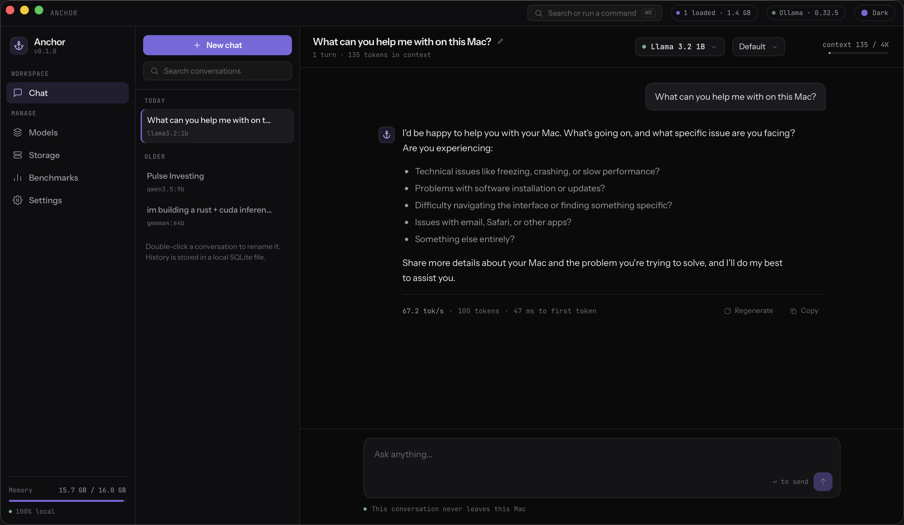
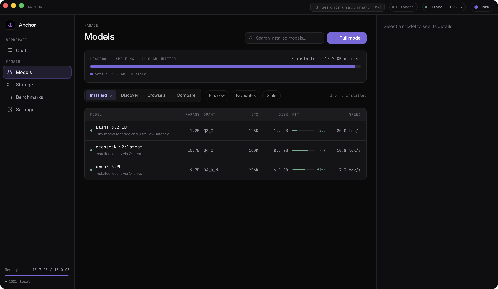
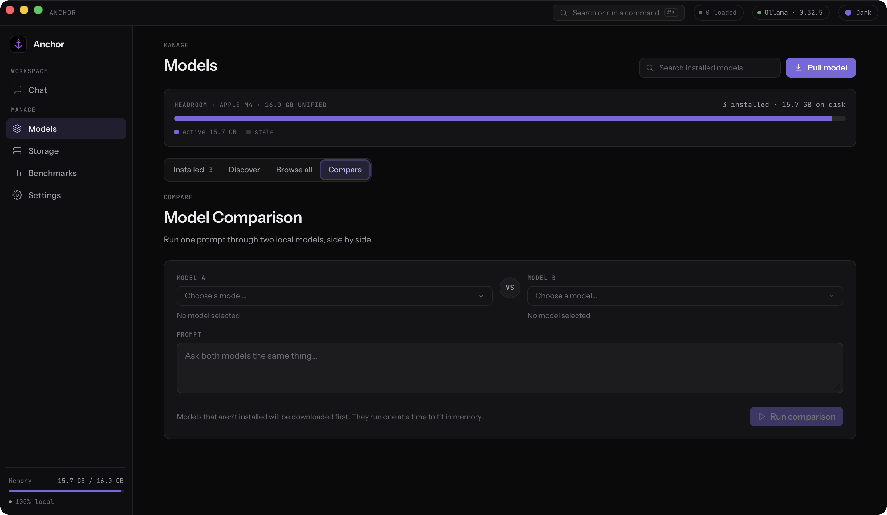
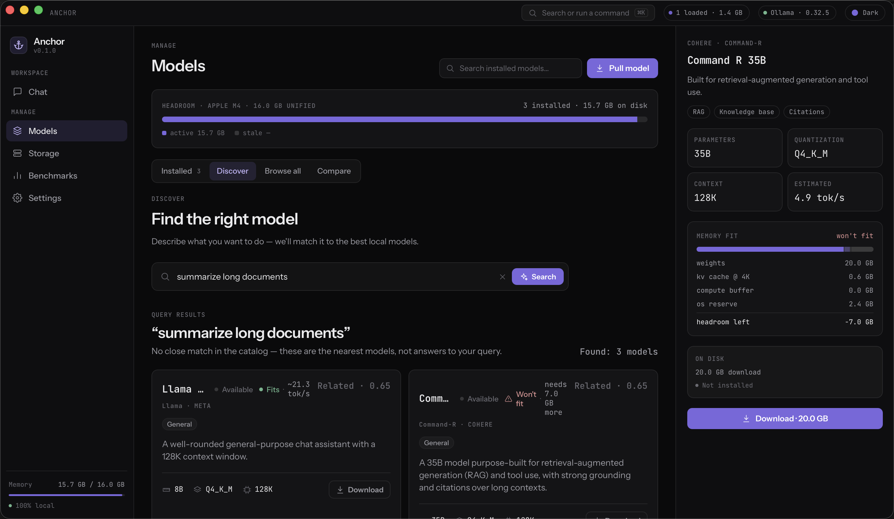
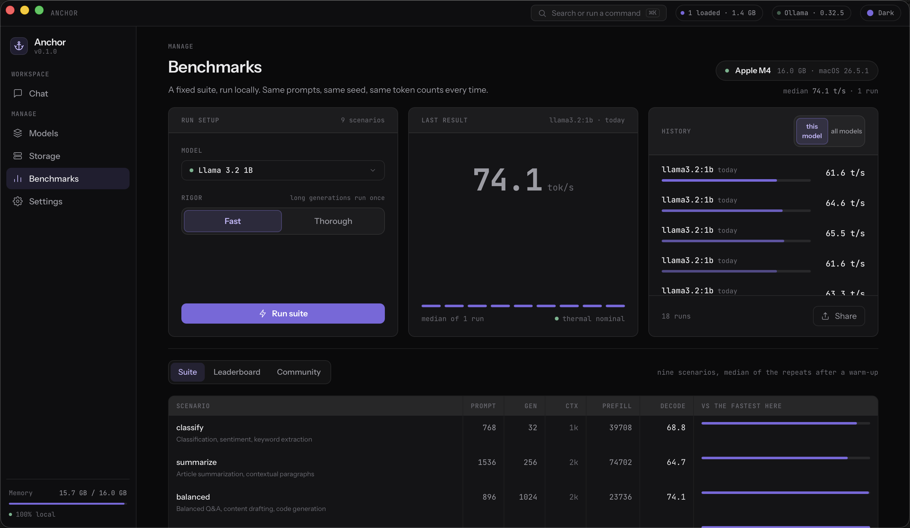
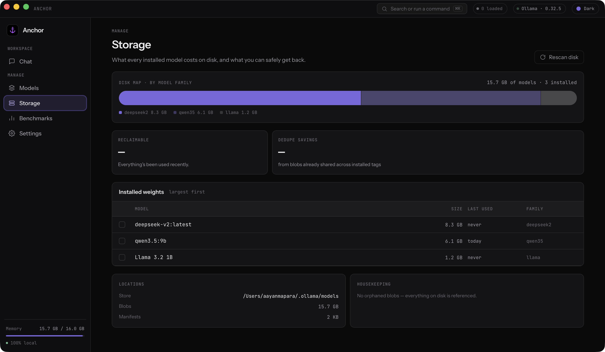
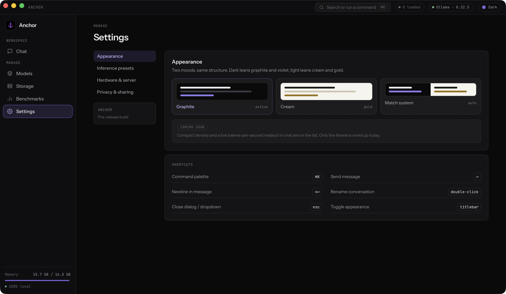

<p align="center">
  <picture>
    <source media="(prefers-color-scheme: dark)" srcset="docs/anchor_dark_word.png">
    
  </picture>
</p>

<h3 align="center">Find, fit, and benchmark local models with ease</h3>

<p align="center">
  
  
  
  
  
  
</p>

> **Status: early-stage.** Signed builds ship from [Releases](https://github.com/amapara27/anchor/releases/latest) and the app updates itself, but interfaces and internals still change often.

## About

Anchor is a compact native macOS tool for finding, checking and testing local AI models. It sits on top of [Ollama](https://ollama.com) and handles the orchestration that makes local models actually usable: discovering and installing models, checking whether one will fit your machine before you pull it, trying what you have installed, benchmarking real throughput on your own hardware, and configuring how models behave — all from one place, no terminal required.

Anchor orchestrates existing runtimes: Ollama for interactive inference and serving benchmarks, plus an optional isolated MLX-LM worker for real-text benchmarks.

Anchor also owns the Ollama server lifecycle: it starts `ollama serve` on launch and shuts it down on quit, so you never need the menubar app or a terminal.

Built for developers, students, researchers, and small business operators who want capable AI running locally without touching a command line. Apple Silicon is the primary target.

## Install

**Requirement:** [Ollama](https://ollama.com/download) must be installed. Anchor starts and stops the server for you, but it does not bundle the inference engine.

### Desktop app

Download the latest `.dmg` from [Releases](https://github.com/amapara27/anchor/releases/latest) and drag Anchor to Applications. It is signed and notarized, so it opens without a Gatekeeper prompt, and it updates itself from then on.

Open **Models → Add model**, pick a suggested model or browse the Ollama library, inspect its memory estimate, and download it. Select an installed model and choose **Try model** to start a chat at the chosen context. Past chats stay in SQLite and are listed by `anchor chat ls`.

No API keys are required. Inference and saved history work locally after setup when Ollama is configured on this Mac. Model downloads, fresh library data, update checks and external sharing use the network.

### CLI

The `anchor` binary is published separately, under `cli-v*` tags:

```bash
curl -fsSL https://github.com/amapara27/anchor/releases/download/cli-v0.1.0/anchor-cli-0.1.0-macos-arm64.tar.gz | tar -xz
sudo mv anchor /usr/local/bin/
```

Use `curl` rather than a browser — the CLI is a bare binary with no notarization ticket, so a browser download gets quarantined and macOS refuses to run it.

## Features

### Try

A quick streaming chat with any installed model, with reasoning/thinking output rendered separately from the answer. Stop a generation mid-stream and keep the partial answer, or regenerate the last turn. **New chat** starts a fresh thread; every chat persists in SQLite (readable with `anchor chat ls|show`) and carries its inference preset. Before Anchor loads a model that isn't already resident, it checks whether swapping it in would blow your memory budget and asks first rather than letting Ollama choke.

<picture>
  <source media="(prefers-color-scheme: light)" srcset="docs/screenshots/chat_light.png">
  
</picture>

### Exploring models

- **Model hub** — every installed Ollama model in one place, cached to SQLite so the list is instant on launch. Download with inline progress, remove, and inspect per-model detail: parameter count, quantization, context window, and file size.
- **Suggested models** — a curated catalog with real GGUF architecture metadata, filterable by name, publisher or use case and sorted by what fits this Mac.
- **Browse the full library** — every model and tag on ollama.com, not just the curated catalog, for when you know what you want by name.
- **Side-by-side comparison** — run the same prompt through two models sequentially and compare their output and measured generation speed.

<picture>
  <source media="(prefers-color-scheme: light)" srcset="docs/screenshots/models_light.png">
  
</picture>
<picture>
  <source media="(prefers-color-scheme: light)" srcset="docs/screenshots/compare_light.png">
  
</picture>

### Fit

The question every other feature answers from a different angle: will this model actually run here? First-launch hardware profiling of CPU, RAM, and GPU — Apple Silicon is special-cased via `system_profiler` for accurate unified-memory readings — feeds a memory-fit engine that sizes weights, KV cache, and compute buffer per (model, quantization, context length) and renders one verdict everywhere a model shows up: the catalog, search results, the compare picker, and the chat model picker can never disagree, because they all call the same estimator. Every installed and not-yet-installed model gets a full breakdown — weights / KV cache / compute buffer / OS reserve — before you spend disk space or memory finding out the hard way.

- **One context for every verdict** — pick 2K to 128K in the Models header and every fit column, filter and inspector re-judges at it (capped at each model's own limit).
- **Per-quant table** — the inspector lists every published quantization of the same model size with its download, estimated RAM and headroom at that context, so you can pick the variant that fits before pulling it.
- **Predicted vs observed memory** — after a measurement, the inspector shows the estimate next to what Ollama actually allocated at that context.
- **Use from other apps** — copyable `ollama run`, OpenAI-compatible base URL and a `curl` snippet for any installed model.

<picture>
  <source media="(prefers-color-scheme: light)" srcset="docs/screenshots/fit_light.png">
  
</picture>

[Screen recording (dark)](docs/recordings/fit_dark.mp4) · [Screen recording (light)](docs/recordings/fit_light.mp4)

### Benchmarks

Measure real tokens/sec and memory use for an installed model on your own hardware, with results stored per model over time and a live waveform while a run is in progress.

**Measure** in the model inspector runs just the headline scenario, so a model's row shows a measured speed instead of an estimate in about a minute. Each run records the Ollama version; when Ollama changes, measured rows are flagged stale, and a re-run keeps the previous speed so the inspector shows the change across the upgrade.

One suite, run in full every time: nine scenarios, each a target input length and capped output shape with a use case attached — classification, summarization, RAG, chain-of-thought reasoning, code generation, and more — at the smallest power-of-two context that holds both. Each scenario is its own row, so a leaderboard always compares models at the same shape rather than averaging incomparable ones. Fast mode runs the long-generation scenarios once instead of three times. Runs also capture thermal state (Apple Silicon's real pressure signal, not the Intel-era fallback), with pressure observed at scenario boundaries recorded alongside the result. Decode uses Ollama timings; prefill excludes cached tokens and TTFT measures the request to first received output. Server KV cache and Flash Attention settings are recorded as unknown when not exposed.

Each result is stored at the context Ollama actually loaded. Context below the requested size invalidates that attempt; the evidence remains. While a run is live, the readout is in chunks/s, which need not equal tokens/s. Stored tok/s uses Ollama's own token count and timing, currently uncalibrated engine diagnostics.

Method v4 freezes each session's requests, hardware/runtime identity and repeat budget before collection. Reruns get new session IDs. Every dispatched warmup and measured attempt retains its raw NDJSON frames, monotonic event offsets, observed context/digest, environment snapshots and terminal outcome. Missing or changed loaded digests invalidate the attempt. Successful scenarios enter history and rankings; incomplete scenarios remain in execution evidence. Run history includes failed/cancelled sessions and an explicit opt-in JSON export containing prompts and output. Existing results stay readable; older results cannot acquire raw events retroactively, and pre-v4 prefill values are unavailable because missing cache counts could have been treated as zero.

Evidence record v1 / formula v1 recalculates request-to-first-output, first-answer, last-content and valid protocol-completion latency from monotonic nanoseconds. Decode is `eval_count / (eval_duration_ns / 1e9)`; prefill is `(prompt_eval_count - prompt_eval_cached_count) / (prompt_eval_duration_ns / 1e9)`. Missing cache counts remain unknown; explicit zero remains zero; fully cached prefill is not applicable. Durations must be positive for rates. Only complete planned scenarios produce descriptive medians, and a metric with missing repeats stays unavailable. These repeats do not establish independent statistical blocks or confidence intervals.

Attempt metadata is saved before dispatch and frames are committed when the attempt finalizes. Graceful errors and cancellation retain evidence. A hard process kill can leave an unfinished record and lose that attempt's buffered frames; an unfinished record is not evidence that a process is still running. Memory remains an Ollama residency snapshot, not peak RSS. Replay verifies record/formula versions and recalculates from raw frames, ignoring exported derived values; it is not an authenticity signature or live-runtime calibration.

Evidence-backed suite-v4 results no longer duplicate raw attempts into `bench_samples`; the existing table remains readable for older runs, and `bench samples` reconstructs the compatibility view from replayed evidence. Schema migration V13 archives retired agent and knowledge-base rows in `retired_feature_archive` (embeddings are preserved as hex JSON) before dropping their unused tables.

`bench calibrate MODEL` retains a separate calibration session with unload/repeat/prefix, one-token cap, natural-stop, Unicode and (when supported) reasoning probes. On the tested local Ollama 0.34.4 llama-server path, it cross-checks the rendered prompt against matching tokenizer IDs and records binary/model hashes. Versioned reports are replayed from the stored observations. Missing capabilities remain unverified, and all engine counters/rates are explicitly diagnostic; calibration never creates ranking rows or qualifies other runs. See [the live calibration findings](docs/ollama-calibration.md) for timing/EOS limits and the exact tested scope. Other versions/backends keep token verification unavailable until their adapter is checked.

In the desktop app, open **Benchmarks**, select a model and use **Measurement validation → Validate measurements** below the results. It runs 7–8 test requests to check Ollama's token counts, cache reuse and response completion, then saves a report; it does not tune the model or change benchmark results. Progress and Stop validation stay available during collection. Expand Request details for individual checks and evidence export, which requires choosing to include prompts and output. Run history labels validation sessions and provides View checks for older results.

**MLX benchmarks:** open **Benchmark**, choose **Runtime → MLX**, select a named local checkpoint, then **Run suite**. Cached Hugging Face checkpoints appear automatically; **Add local checkpoint…** opens a folder picker. MLX uses the same nine workloads, Fast/Thorough repeats, live progress and Stop as Ollama. Initial support is MLX-LM Llama with a chat template and standard KVCache. This optional feature requires [uv](https://docs.astral.sh/uv/); first use creates a locked environment in Anchor's data directory. It does not download model weights or enable remote model code.

Each request generates real text, ending at EOS or its output cap, with a fresh prompt cache. Actual formatted input IDs, sampled output IDs, finish reasons, monotonic client events and allocator windows are saved with the frozen plan. Measurement checks run automatically; their detailed report sits below the suite. Load and resident-inference allocator peaks remain separate and are not total Mac memory.

MLX-LM phase rates remain **diagnostic** because its first-token, EOS and consumer-time conventions differ from Ollama. Client latency includes worker IPC and formatting. Results and leaderboard queries stay runtime-scoped; MLX rows also match tokenizer/template, source/runtime, workload and context. They are descriptive observations, not qualified cross-runtime comparisons. Existing session/attempt tables provide replayed results without duplicate sample writes. Run history preserves failed/cancelled work and older synthetic validation reports; exports require explicit content consent. See [MLX measurements](docs/mlx-measurements.md) for tested scope and limits.

<picture>
  <source media="(prefers-color-scheme: light)" srcset="docs/screenshots/benchmarks_light.png">
  
</picture>

[Screen recording (dark)](docs/recordings/benchmarks_dark.mp4) · [Screen recording (light)](docs/recordings/benchmarks_light.mp4)

### Storage

A real scan of Ollama's on-disk store: total blob and manifest size, how much content-addressed sharing already saves you, and which blob files nothing references anymore so they can be reclaimed. When any manifest can't be read the scan reports that instead of offering orphans — an incomplete reference graph can't distinguish a dead blob from a live one, and the deletion is irreversible.

<picture>
  <source media="(prefers-color-scheme: light)" srcset="docs/screenshots/storage_light.png">
  
</picture>

### Configuration

- **Inference presets** — system prompt, temperature, top-p, and context length per conversation, autosaved as you type.
- **Hardware panel** — the profiled chip, memory, and core counts Anchor is basing every fit verdict on, with a manual re-profile.
- **Appearance** — dark (graphite/violet) or light (cream/gold) theme, or follow the system.
- **Privacy** — a standing reminder that inference, chats, and history never leave the machine.

<picture>
  <source media="(prefers-color-scheme: light)" srcset="docs/screenshots/settings_light.png">
  
</picture>

## Using the CLI

`anchor` is the terminal front-end over the same crates — and the same database, so a trial started in either is stored in one place, and a benchmark run there lands in the app's history.

```bash
anchor models ls                            # installed models
anchor models browse --filter qwen          # everything on ollama.com
anchor models compare llama3.2:1b qwen3.5:9b "why is the sky blue?"
anchor fit deepseek-v2 --ctx 32768          # weights + KV cache + verdict
anchor chat -m llama3.2:1b                  # interactive; omit -m to continue with --conversation
anchor bench scenarios                      # what the suite measures
anchor bench run llama3.2:1b --repeats fast
anchor bench top --scenario balanced        # rank every model on one scenario
anchor bench sessions                       # includes failed/cancelled executions
anchor bench export SESSION_ID --include-content > evidence.json
anchor bench replay evidence.json           # offline recalculation from raw evidence
anchor bench calibrate llama3.2:1b           # live, fixed-plan Ollama calibration session
anchor bench calibrate llama3.2:1b --output ./calibration  # isolated DB + full synthetic evidence
node tools/calibrate-ollama.mjs ./calibration/SESSION_ID.json  # independent replay/arithmetic check
anchor storage scan
anchor settings server --start
```

Every command takes `--json` for scripting, and `--host` to point at a non-default Ollama.

Anything that deletes — `models rm`, `chat rm`, `storage clean` — asks first, and takes `--yes` to skip the prompt. The prompt reads from stdin, so a piped or redirected invocation without `--yes` declines rather than proceeding; scripts need the flag. Ctrl-C during `bench run` is a stop rather than a kill: the suite ends after the scenario in flight, keeps what it measured, and unloads the model — press it twice to quit immediately.

One caveat: the app serialises memory-heavy work internally, but a separate CLI process can't see that lock. Don't benchmark from the terminal while the app is generating — the run would measure the contention rather than the model.

## Build from source

### Prerequisites

- macOS (Apple Silicon recommended)
- [Ollama](https://ollama.com/download) installed
- Rust (stable) — [rustup](https://rustup.rs)
- Node 20+ and pnpm 10+
- Xcode Command Line Tools (`xcode-select --install`)

### Run it

```bash
git clone https://github.com/amapara27/anchor.git
cd anchor
pnpm install
pnpm dev                                   # app in dev mode
cargo install --path crates/anchor-cli     # the CLI, from source
```

Anchor profiles your hardware on first use.

`pnpm build` produces an unsigned local bundle. Signed, notarized releases are cut with `pnpm release:mac`, which needs a Developer ID certificate and an App Store Connect API key.

## Architecture

A pnpm + Cargo monorepo. Domain logic lives in the crates; both front-ends — the Tauri layer and the CLI — are thin wrappers over them, which keeps everything testable without a webview.

```
anchor/
├── apps/desktop/
│   ├── src/                # React + Tailwind v4 frontend (TypeScript)
│   └── src-tauri/          # Tauri 2 shell — thin command wrappers only
└── crates/
    ├── anchor-cli/         # `anchor` terminal front-end over the same crates + database
    ├── anchor-core/        # shared domain types, the curated catalog + the memory-fit engine; UI- and Tauri-free
    ├── anchor-hub/         # model registry, SQLite, Ollama REST, server lifecycle
    └── anchor-system/      # macOS hardware profiling via system_profiler
```

| Layer | Technology |
| --- | --- |
| Frontend | React 19, Tailwind v4, Vite |
| App framework | Tauri 2 |
| Backend | Rust, Tokio, `reqwest` |
| Inference | Ollama REST API |
| Storage | SQLite via `rusqlite`, versioned migrations |
| Hardware | `system_profiler` subprocess |

All state — the registry, conversations and benchmark runs — lives under the app's data directory (`~/Library/Application Support/…/registry.db`). Inference and stored chats remain local when Ollama uses its default local host. A remote `OLLAMA_HOST` receives your prompts. Downloads, fresh library/metadata requests, update checks and explicit sharing can use the network; the app has no automatic telemetry path.

## Development

```bash
pnpm dev                                     # run the app (Vite on :1420)
pnpm --filter @anchor/desktop build          # typecheck + frontend build (fast, no Rust)
cargo run -p anchor-cli -- models ls         # run the CLI from the workspace
cargo test -p anchor-cli -p anchor-core -p anchor-hub -p anchor-system   # logic tests, no webview
node --experimental-strip-types \
  apps/desktop/src/lib/engine.selfcheck.ts   # the frontend's memory-fit fixtures
pnpm --filter @anchor/desktop test:e2e      # browser, HTTP/SQLite measurements, native IPC
pnpm --filter @anchor/desktop test:e2e:measurements # headless HTTP/SQLite measurements
```

E2E tests require macOS, Rust, pnpm and Playwright Chromium (`pnpm --filter @anchor/desktop exec playwright install chromium`). They run the real interface and native IPC against an isolated Ollama HTTP fixture and temporary database; they do not download model weights or touch your installed models.

Opt-in MLX E2E reads a local checkpoint on an Apple GPU: set `ANCHOR_MLX_E2E_MODEL` to its directory and run `cargo test -p anchor-hub --test mlx_suite_e2e -- --ignored --nocapture`. With the same variable, `pnpm --filter @anchor/desktop test:e2e:native` also checks the real GUI → uv worker → GPU → SQLite path and Stop. Real-text suite artifacts stay in `.internal/benchmarking/mlx-suite-validation/`; the separate legacy synthetic harness is exercised with `--test mlx_e2e` and retains artifacts in `.internal/benchmarking/mlx-validation/`; normal tests remain model-free. Worker dependencies live in `workers/mlx/{pyproject.toml,uv.lock}`; `requirements.txt` is the generated hash-pinned export. Regenerate it with `uv export --project workers/mlx --frozen --no-dev --no-emit-project --output-file workers/mlx/requirements.txt` after changing the lock.

Conventions worth knowing before contributing:

- Domain logic goes in `crates/*`, never in `src-tauri` or `anchor-cli`. Both front-ends delegate.
- The memory-fit math exists twice on purpose: `anchor_core::fit` (Rust) and `apps/desktop/src/lib/kv.ts` + `fit.ts` (TS, so the context slider recomputes without IPC). Their test fixtures mirror each other — change both, or neither.
- Frontend types in `apps/desktop/src/types.ts` mirror the Rust serde types — keep them in sync.
- Tailwind v4 via the Vite plugin. There is no `tailwind.config.js` or `postcss.config.js`.
- SQLite migrations are append-only: never edit a shipped `V*` constant, add the next one.

## Currently supported

- **macOS**, Apple Silicon as the primary target. Intel Macs build and run but are untested.
- **[Ollama](https://ollama.com)** for interactive inference and serving benchmarks; optional **MLX-LM Llama** real-text benchmarks on Apple Silicon, with runtime-scoped results.
- **Desktop app and CLI**, sharing one database, released separately: `v*` tags for the app, `cli-v*` for the CLI.

## In the pipeline

Roadmap items, not promises with dates:

- **A guided first run** — hardware profile, Ollama check, and a first model chosen to fit the machine, instead of dropping you into an empty app.
- **A community benchmark leaderboard.** The schema is already there (`source`/`synced_at` columns on every bench run) and every run stores a full result today — there's just no results server yet, so all comparisons are local-only for now.
- **Publishing controls** for what a shared benchmark run includes, once there's somewhere to publish it to.
- **Importing models from Hugging Face** — pull a GGUF straight from a repo instead of waiting for it to land in Ollama's library.
- **Windows and Linux** support.
- **Additional inference engines** beyond Ollama, starting with direct llama.cpp integration.
- **Compact density and a live tokens/sec readout** in chat.

## License

MIT
