<p align="center">
  <picture>
    <source media="(prefers-color-scheme: dark)" srcset="docs/anchor_dark_word.png">
    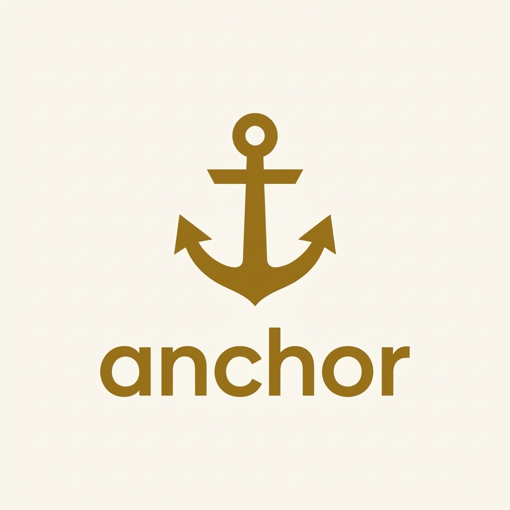
  </picture>
</p>

<h3 align="center">Find, fit, and benchmark local models with ease</h3>

<p align="center">
  
  
  
  
  
  
</p>

> **Status: early-stage.** Signed builds ship from [Releases](https://github.com/amapara27/anchor/releases/latest) and the app updates itself, but interfaces and internals still change often.

<picture>
  <source media="(prefers-color-scheme: light)" srcset="docs/screenshots/find-fit-128k-light.png">
  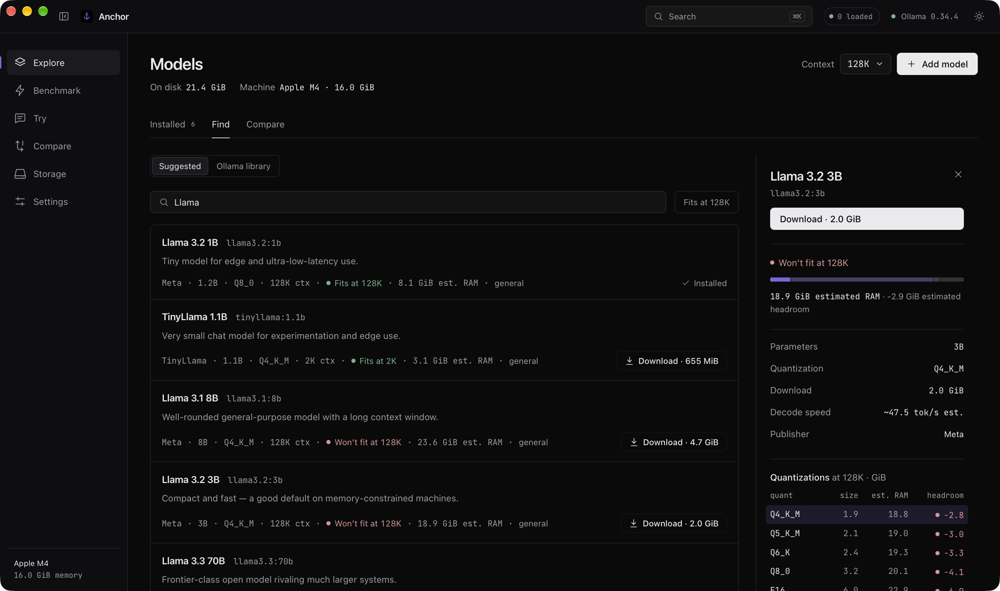
</picture>

## About

Running a model locally usually goes: pick one, download several gigabytes, find out it doesn't fit, and never learn how fast it would have been. Anchor answers those questions **before** you pay for them, then measures the real numbers on your own Mac.

It is a native macOS app (and a terminal CLI over the same database) for Apple Silicon. It sits on top of [Ollama](https://ollama.com), plus an optional isolated [MLX-LM](https://github.com/ml-explore/mlx-lm) worker, and follows one story:

1. **Find** a model, from a curated catalog or the whole Ollama library.
2. **Fit** — see whether it will run on this machine, at the context length you want, before downloading.
3. **Benchmark** — measure decode speed and time to first token on your hardware, on Ollama or MLX.
4. **Try and compare** — chat with it, or run one prompt through two models side by side.
5. **Manage** — see what your models cost on disk and clean up.

Anchor also owns the Ollama server lifecycle (it starts `ollama serve` on launch and stops it on quit), so you never need the menubar app or a terminal. It is built for developers, students, researchers and anyone who wants capable AI running locally. No API keys, and no automatic telemetry.

**Here for the benchmark numbers?** [Read how Anchor measures performance](docs/benchmark-methodology.md): timing boundaries, validation checks and the limits of comparisons.

## Install

**Requirements:** macOS 15 Sequoia or later on Apple Silicon, and [Ollama](https://ollama.com/download) 0.32 or later. Anchor starts and stops the server for you but does not bundle the inference engine.

### Desktop app

Download the latest `.dmg` from [Releases](https://github.com/amapara27/anchor/releases/latest) and drag Anchor to Applications. It is signed and notarized, opens without a Gatekeeper prompt, and updates itself from then on. Anchor profiles your hardware on first launch.

### CLI

The CLI is published on PyPI as `anchr`; the executable is `anchor`.

```bash
uv tool install anchr      # needs uv: https://docs.astral.sh/uv/
anchor                     # open the terminal workspace
uv tool upgrade anchr      # update later
```

See [The CLI](#the-cli) below, or build from source (see [Build from source](#build-from-source)).

## Features

### Find and fit

Open **Explore** to browse a curated catalog (filter by name, publisher or use case, sorted by what fits this Mac) or the full ollama.com library. Every model shows one verdict — fits, tight, or won't fit — computed from your chip and memory by a single estimator, so the catalog, search, compare picker and chat picker can never disagree.

- **One context for every verdict.** Pick 2K to 128K in the header and every column, filter and inspector re-judges at that context (capped at the model's own limit).
- **Full breakdown.** Weights, KV cache, compute buffer and OS reserve before you spend disk or memory finding out the hard way.
- **Per-quant table.** Every published quantization of a model size with its download, estimated RAM and headroom, so you can pick the variant that fits.
- **Predicted vs observed.** After a measurement, the inspector shows the estimate next to what Ollama actually allocated.
- **Use from other apps.** Copyable `ollama run`, OpenAI-compatible base URL and a `curl` snippet for any installed model.

<picture>
  <source media="(prefers-color-scheme: light)" srcset="docs/screenshots/find-fit-32k-light.png">
  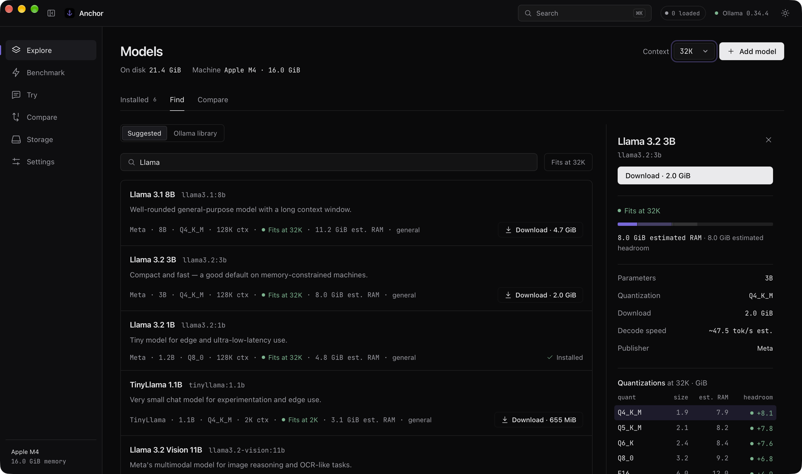
</picture>

### Benchmark

Run nine text workloads (classification, summarization, explanation, creative writing, document Q&A, detailed replies, reasoning and code generation) on **Ollama** or the optional **MLX** runtime. Pick a model, then **Run suite**. Fast and Thorough control the repeat budget.

The headline numbers are **decode speed after the first token** and **TTFT**, the wait from request dispatch to first output. A live waveform shows chunks/s during the run, and the **Leaderboard** ranks every benchmarked model per workload and runtime.

<picture>
  <source media="(prefers-color-scheme: light)" srcset="docs/screenshots/bench-ollama-light.png">
  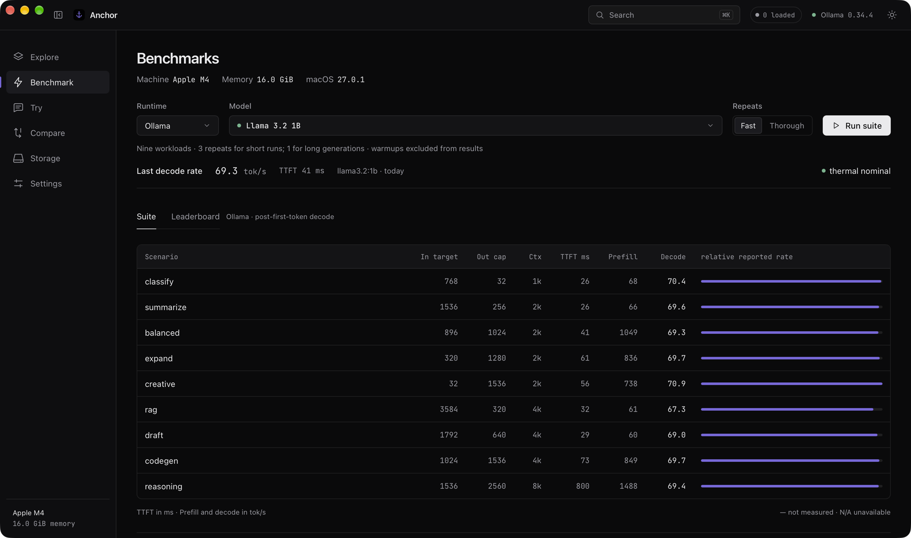
</picture>
<picture>
  <source media="(prefers-color-scheme: light)" srcset="docs/screenshots/bench-leaderboard-light.png">
  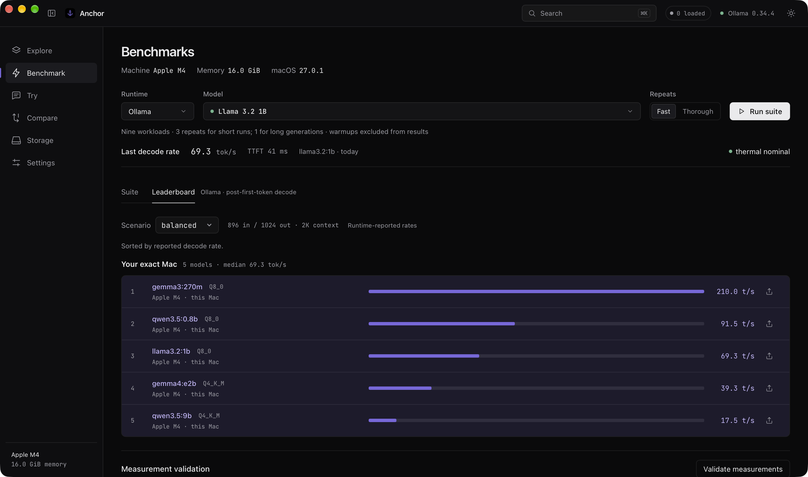
</picture>

- **Evidence, not just numbers.** Every session keeps its configuration, raw events, warmups and failed or cancelled attempts. Missing measurements stay unavailable instead of showing as zero.
- **Measurement validation.** One click checks token counts, cache reuse and response completion against what the runtime reports.
- **MLX in the same flow.** On Apple Silicon with [uv](https://docs.astral.sh/uv/), choose **MLX → model → Download model → Run suite**. Anchor verifies pinned checksums and builds the locked worker environment. 64 paired catalog entries span Ollama and MLX, including Qwen 3–3.8, Gemma 3/4 and Ministral 3.

<picture>
  <source media="(prefers-color-scheme: light)" srcset="docs/screenshots/bench-mlx-light.png">
  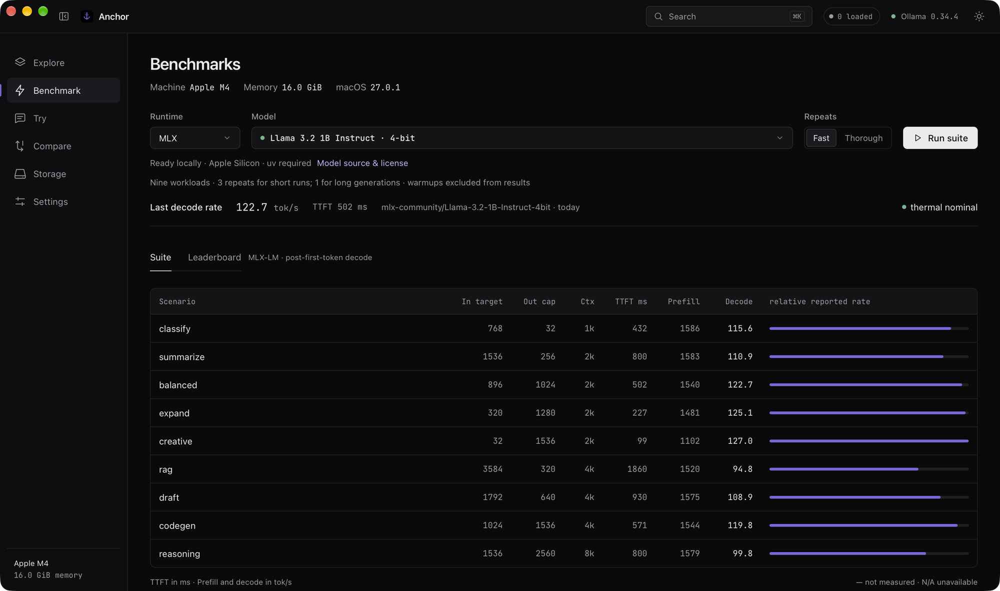
</picture>

Rankings describe reported rates for the selected workload and runtime; quality equivalence and cross-runtime winner claims are not checked. The [methodology](docs/benchmark-methodology.md) has the workload table, timing formulas and reproduction steps. Scoped findings: [Ollama](docs/ollama-calibration.md), [MLX catalog coverage](docs/mlx-measurements.md#catalog-review--october-29-2026).

### Try and compare

**Try** is a streaming chat with any installed model, with reasoning output shown separately. Stop mid-stream and keep the partial answer, or regenerate the last turn. Before loading a model that isn't resident, Anchor checks whether the swap would blow your memory budget and asks first. Chats persist in SQLite and carry their inference preset (system prompt, temperature, top-p, context).

**Compare** runs one prompt through two models and shows both outputs with measured generation speed.

<picture>
  <source media="(prefers-color-scheme: light)" srcset="docs/screenshots/try-chat-light.png">
  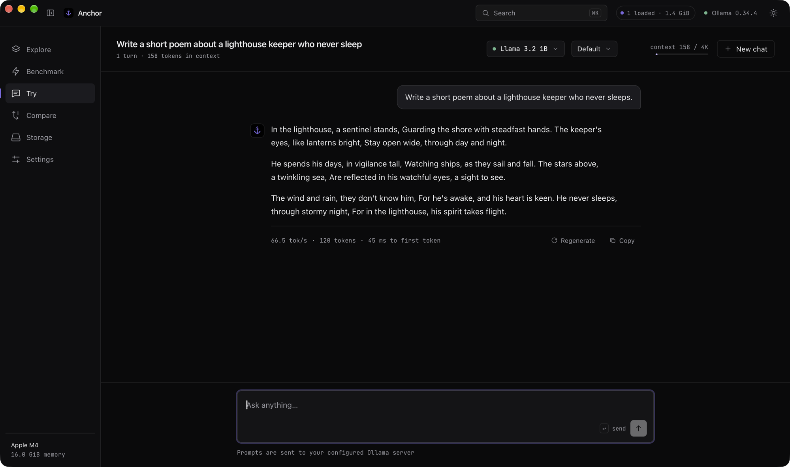
</picture>
<picture>
  <source media="(prefers-color-scheme: light)" srcset="docs/screenshots/compare-models-light.png">
  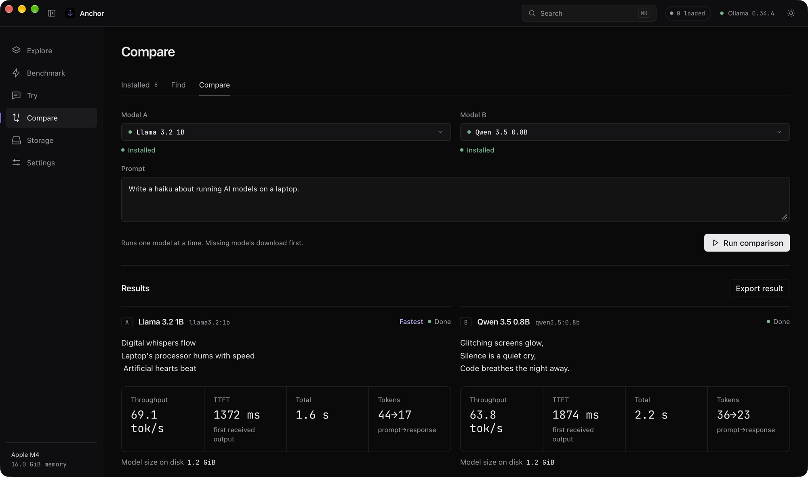
</picture>

### Storage

A real scan of Ollama's on-disk store: total size, savings from shared files, which models are largest or unused, and blobs no installed model references. The scan is read-only because an active download may still need an unreferenced blob; remove installed models through Ollama.

<picture>
  <source media="(prefers-color-scheme: light)" srcset="docs/screenshots/storage-overview-light.png">
  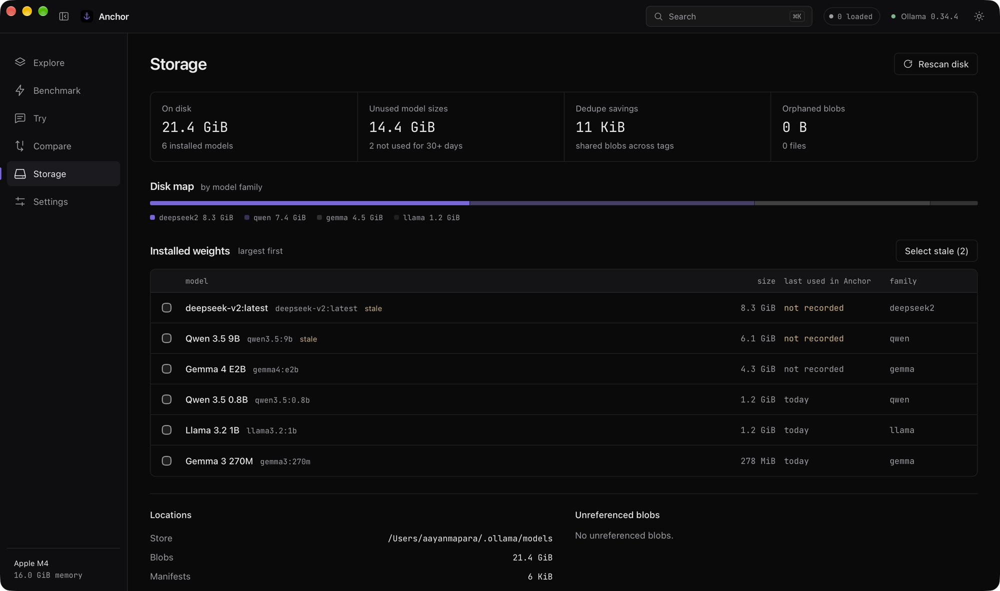
</picture>

### Settings

Inference presets, a hardware panel (the chip and memory every verdict is based on, with a manual re-profile), and a dark (graphite/violet) or light (cream/gold) theme that can follow the system.

## The CLI

The `anchor` CLI is the same product in a terminal: it shares benchmark history, chats and presets with the desktop app. Run `anchor` for a keyboard workspace, type `/` to search commands, and use `Tab` and `Esc` to move around. Everything is also scriptable with plain commands and `--json`.

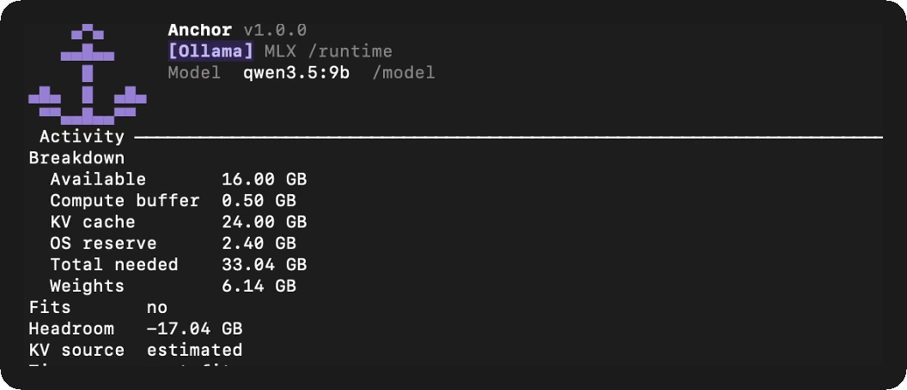

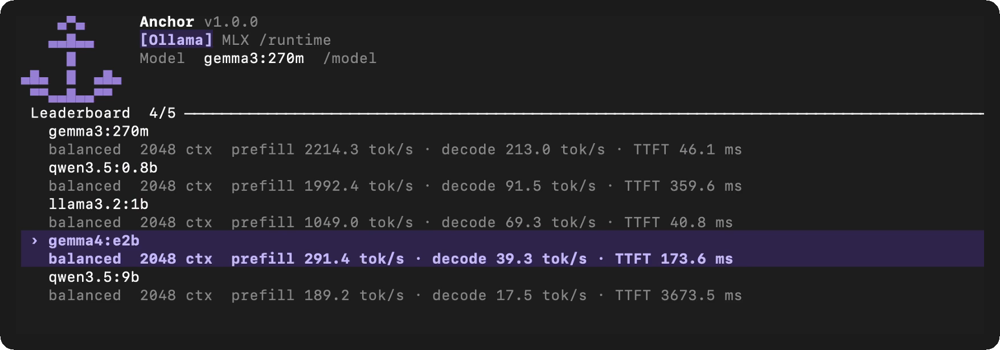

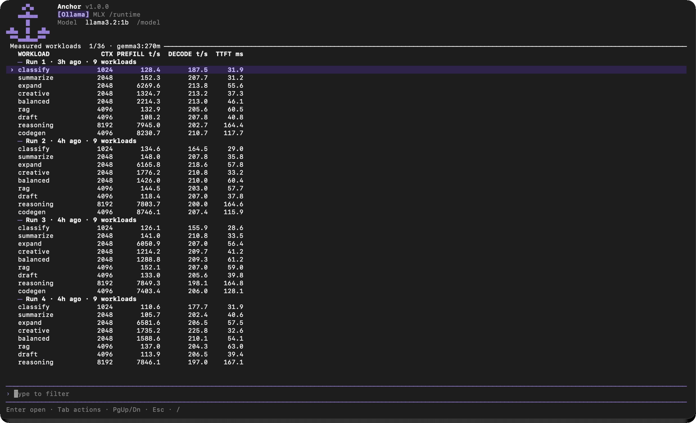

```bash
anchor models browse --filter qwen          # everything on ollama.com
anchor fit deepseek-v2 --ctx 32768          # weights + KV cache + verdict
anchor bench run llama3.2:1b --repeats fast
anchor bench top --scenario balanced        # rank every model on one workload
anchor models compare llama3.2:1b qwen3.5:9b "why is the sky blue?"
```

Slash commands inside the workspace: `/model`, `/runtime`, `/library`, `/fit`, `/bench`, `/leaderboard`, `/results`, `/chat`, `/compare`, `/help`. The [CLI guide](docs/cli-guide.md) covers interactive controls, every command and scripting details.

## Build from source

Prerequisites: macOS 15+ on Apple Silicon, [Ollama](https://ollama.com/download), Rust (stable, via [rustup](https://rustup.rs)), Node 20+ with pnpm 10+, and Xcode Command Line Tools (`xcode-select --install`).

```bash
git clone https://github.com/amapara27/anchor.git
cd anchor
pnpm install
pnpm dev                                   # app in dev mode
cargo install --path crates/anchor-cli     # the CLI, from source
```

`pnpm build` produces an unsigned local bundle. Signed, notarized releases are cut with `pnpm release:mac`, which needs a Developer ID certificate and an App Store Connect API key.

## Architecture

A pnpm + Cargo monorepo. Domain logic lives in the crates; both front-ends (the Tauri layer and the CLI) are thin wrappers over them, which keeps everything testable without a webview.

```
anchor/
├── apps/desktop/
│   ├── src/                # React + Tailwind v4 frontend (TypeScript)
│   └── src-tauri/          # Tauri 2 shell: thin command wrappers only
├── crates/
│   ├── anchor-cli/         # `anchor` terminal front-end over the same crates + database
│   ├── anchor-core/        # domain types, curated catalog, memory-fit engine; UI- and Tauri-free
│   ├── anchor-hub/         # model registry, SQLite, Ollama REST, benchmarks, server lifecycle
│   └── anchor-system/      # macOS hardware profiling via system_profiler
└── workers/mlx/            # optional isolated MLX-LM worker (uv-managed)
```

| Layer | Technology |
| --- | --- |
| Frontend | React 19, Tailwind v4, Vite |
| App framework | Tauri 2 |
| Backend | Rust, Tokio, `reqwest` |
| Inference | Ollama REST API; optional MLX-LM worker |
| Storage | SQLite via `rusqlite`, versioned migrations |
| Hardware | `system_profiler` subprocess |

**Privacy.** All state (registry, chats, benchmark runs) lives in the app's data directory (`~/Library/Application Support/com.anchor.desktop/registry.db`). Inference and stored chats stay local when Ollama uses its default local host; a remote `OLLAMA_HOST` receives your prompts. Downloads, library and metadata requests, update checks and explicit sharing use the network. There is no automatic telemetry.

## Development

```bash
pnpm dev                                     # run the app (Vite on :1420)
pnpm --filter @anchor/desktop build          # typecheck + frontend build (fast, no Rust)
cargo run -p anchor-cli -- models ls         # run the CLI from the workspace
pnpm test:e2e                                # full acceptance, incl. real Ollama + MLX
pnpm test:e2e --surface cli                  # CLI-only acceptance
pnpm test:e2e --profile fixtures             # model-free local workflows + native app
pnpm test:e2e --profile ci                   # what CI runs
pnpm test:e2e --only native                  # one stage, for reproduction
```

One E2E runner replaces unit tests and is what CI uses. The [testing map and repair loop](docs/testing.md) document every stage, failure artifacts, targeted reruns, the opt-in live MLX checks and manual limits. Full local acceptance needs Apple Silicon, Rust, pnpm, uv, Ollama, network access and Playwright Chromium; your installed models and normal app database are untouched.

Conventions worth knowing before contributing:

- Domain logic goes in `crates/*`, never in `src-tauri` or `anchor-cli`. Both front-ends delegate.
- The memory-fit math exists twice on purpose: `anchor_core::fit` (Rust) and `apps/desktop/src/lib/kv.ts` + `fit.ts` (TS, so the context slider recomputes without IPC). Both run against shared fixtures; change both, or neither.
- Frontend types in `apps/desktop/src/types.ts` mirror the Rust serde types; keep them in sync.
- Tailwind v4 via the Vite plugin: no `tailwind.config.js` or `postcss.config.js`.
- SQLite migrations are append-only: never edit a shipped `V*` constant, add the next one.
- The desktop app and CLI release separately: `v*` tags for the app, `cli-v*` for the CLI ([CLI publishing](docs/cli-publishing.md)).

## Roadmap

Items, not promises with dates:

- **A guided first run**: hardware profile, Ollama check, and a first model chosen to fit the machine.
- **A community benchmark leaderboard.** The schema is ready (`source`/`synced_at` on every run) but there is no results server yet, so comparisons are local-only.
- **Publishing controls** for what a shared benchmark run includes.
- **Importing models from Hugging Face** straight from a repo.
- **Windows and Linux** support, and **more inference engines** starting with direct llama.cpp.
- **Compact density controls** in chat.

## License

MIT
