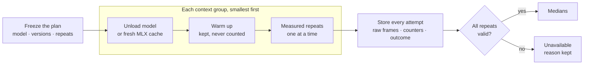
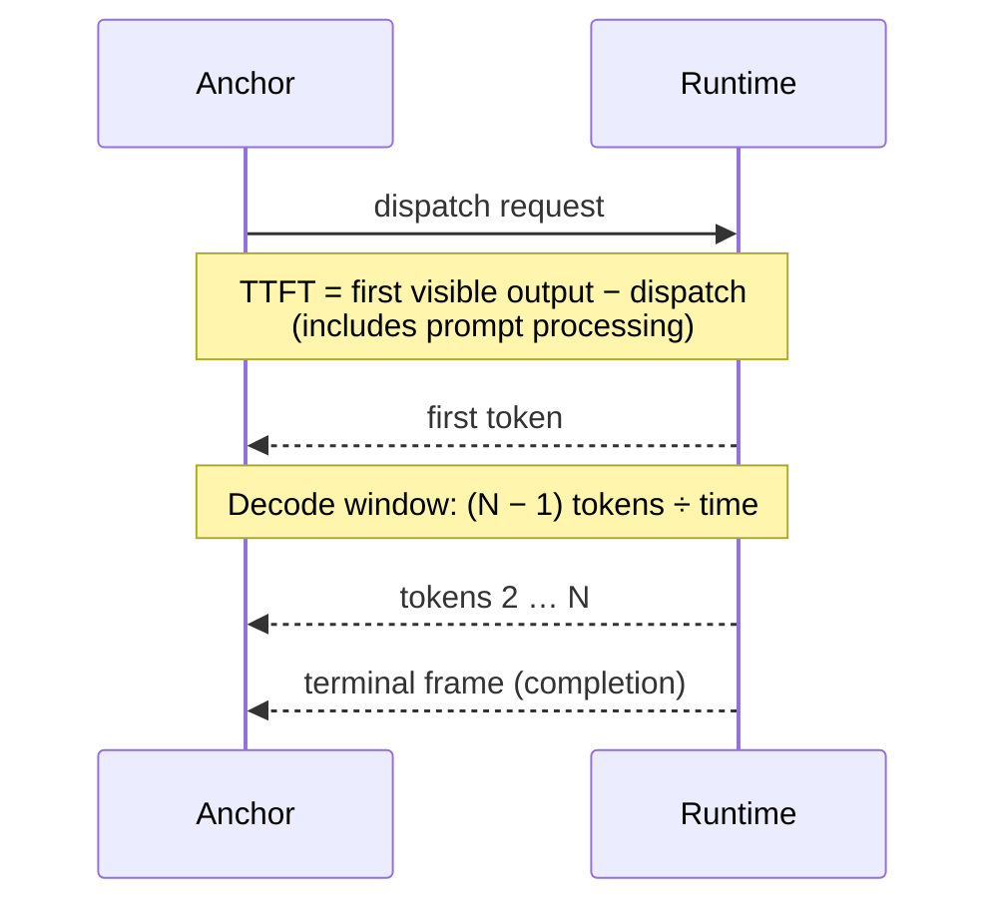

# Benchmark methodology

**Method v5 · Formula 2 · Prompt catalog 1 · Updated November 19, 2026**

Anchor runs the same set of text tasks on local models and records how each runtime performs on your Mac. This page explains what the numbers mean, how they are collected, what has been checked live, and what you can safely compare.

## The short version

- **Decode rate** is generated tokens per second *after* the first token.
- **TTFT** (time to first output) is how long you wait from sending a request until text first appears.
- **Ollama and MLX results stay separate.** Their timers and memory figures measure different things, so Anchor never declares a cross-runtime winner.
- **Every session keeps its raw evidence locally**, so any result can be exported and recalculated offline.
- **Speed, not quality.** A fast wrong answer is still a valid speed observation.

This documents the implementation that ships today. It is not an MLPerf-certified result or an independent GPU-only measurement.

## What the suite runs

Nine workloads run on **Ollama** (streaming HTTP) or the optional **MLX-LM worker** (a separate local process). Each is reported on its own; there is no combined speed score.

| Workload | Task | Input tokens (target) | Max output | Context |
|---|---|---:|---:|---:|
| Classification | Classify a passage and extract keywords | 768 | 32 | 1,024 |
| Summarization | Summarize a passage | 1,536 | 256 | 2,048 |
| Expansion | Explain a passage with an example | 320 | 1,280 | 2,048 |
| Creative writing | Write a story opening | 32 | 1,536 | 2,048 |
| Balanced | Answer, draft documentation and include code | 896 | 1,024 | 2,048 |
| Document Q&A | Answer questions about the supplied passage | 3,584 | 320 | 4,096 |
| Detailed reply | Draft a multi-paragraph response | 1,792 | 640 | 4,096 |
| Reasoning | Analyze the passage's causal argument | 1,536 | 2,560 | 8,192 |
| Code generation | Write a function and example tests | 1,024 | 1,536 | 4,096 |

- These are **workload shapes, not accuracy tests.** Most prompts are prose about the printing press plus a task instruction. Document Q&A puts the document in the prompt; no retrieval is timed.
- **Input sizes are targets** (built at ~4 bytes per token). Each model's tokenizer and chat template set the real count, which is recorded.
- **Output sizes are caps.** A natural early stop is valid and the actual count is kept.
- **Context** is the next power of two at or above `input + output cap + 64`. MLX fails rather than truncates when the prompt doesn't fit; Ollama invalidates an attempt whose loaded context is missing or too small.

Prompts and order are versioned in [`prompts.rs`](../crates/anchor-hub/src/bench/prompts.rs). **Balanced** is the headline workload: **Measure** in the inspector runs it alone, and **Run suite** runs all nine.

## How a run works



1. **Freeze the plan** before any work: model identity, runtime and hardware, method and prompt versions, requests, repeat budget and warmups.
2. **Run sequentially** (concurrency one), grouped by context then output cap. Ollama unloads before each context group; MLX loads once and uses a fresh prompt cache per request.
3. **Warm up each context** with a short prompt (64-token cap). Warmups are stored but never enter medians. They don't guarantee cold filesystem or compilation caches.
4. **Collect repeats.** Thorough runs every workload 3×. Fast runs workloads with caps ≥ 1,024 once and the rest 3× (17 measured attempts plus 4 warmups, versus 27 plus 4).
5. **Keep everything.** Failed, invalid, cancelled and timed-out attempts stay in evidence. Only a complete, valid workload produces medians.

Ollama uses temperature 0, thinking off, no extra system prompt and a 60 s keep-alive. MLX uses greedy decoding, the checkpoint's chat template and thinking off. No seed is set, so this isn't bit-for-bit determinism. Ollama repeats may reuse its prompt cache; cache counters are recorded when reported, otherwise cache state is marked unknown.

## What each number means

A **token** is a tokenizer unit. A streamed **chunk** can hold several tokens, part of a word, or nothing, so Anchor counts the two separately. Client timings use monotonic nanosecond clocks in Rust, outside UI rendering; the MLX worker uses its own clock, and durations are never mixed across clocks.



| Measurement | Calculation | Notes |
|---|---|---|
| TTFT | First nonempty reasoning or answer output − dispatch | Includes HTTP or process overhead. Headers and empty frames don't count. |
| First-answer latency | First answer output − dispatch | Only when the runtime separates reasoning from answer (not MLX today). |
| Completion latency | Valid terminal frame − dispatch | Partial output from a failure is kept but not counted as complete. |
| Ollama decode (GGUF) | `(eval_count − 1) × 1e9 / eval_duration_ns` | Engine token accounting; can include hidden end tokens. |
| Ollama decode (safetensors, MLX runner) | `eval_count × 1e9 / eval_duration_ns` | That runner's timer already covers the first token. |
| MLX decode | `(sampled tokens − 1) × 1e9 / (terminal ns − first-sample ns)` | Worker clock; includes end tokens, process communication and final sync. |
| Ollama prefill | `(prompt_eval_count − prompt_eval_cached_count) × 1e9 / prompt_eval_duration_ns` | Needs valid cache counts (Ollama 0.33.3+). |
| MLX prefill | MLX-LM's reported `prompt_tps` | Runtime-reported, not independently timed. |
| Load | Ollama warmup `load_duration`, or MLX's timed load window | Not full app cold start. |
| Live waveform | Nonempty chunks per second | Activity indicator only. |

Example: 300 ms to first output, then 99 more tokens over one second, is **300 ms TTFT** and **99 tok/s decode**. TTFT is never folded into the decode timer.

### Why the first token is excluded

Ollama's GGUF runners count the first token but start the generation timer *after* producing it (it falls out of the last prompt batch). This holds in every release checked from source, 0.3.14 through 0.40.15. Including it inflates short replies: a one-token answer reports a 1 µs timer and 1,000,000 tok/s. Formula 2 subtracts that token, and a reply of one token or fewer has **no** decode rate rather than a fake zero or infinity. Each session records which convention applied, from the model format Ollama reports.

### Memory

| Observation | What it is | What it isn't |
|---|---|---|
| Ollama resident bytes | `/api/ps` snapshot while loaded | Request peak, process RSS, or GPU-only usage |
| MLX load peak | Allocator peak from reset through weight load | App startup or total process memory |
| MLX inference peak | Per-request allocator peak, both streams drained | Exact KV size or total Mac memory |

Values are stored in bytes and shown in binary units (MiB/GiB). CPU, GPU and allocator figures are never added together on unified memory. For *predicted* memory before a load, see the [fit methodology](fit-methodology.md).

### Missing values and medians

- **Unknown is not zero.** Missing counters stay unknown; a recorded zero stays zero.
- A valid one-token reply is a completed request with a TTFT and no decode rate.
- A workload's median needs a value for **every** planned repeat. Missing values are never dropped to get a better median.
- Repeats are observations within one session, not independent experiments. No confidence intervals or significance tests are reported.

## How measurements are validated

| Layer | What is checked | Limit |
|---|---|---|
| Collector fixtures | Streaming timing, fragmented and empty frames, reasoning, cache arithmetic, malformed or missing counters, cancellation, persistence and export replay | Validates the math, not GPU execution |
| Desktop workflows | Browser and native macOS tests drive selection, run/stop, saved results and validation reports through real IPC | Mocked runtimes aren't performance data |
| Installed Ollama | Tokenizer, cache and completion probes; short, long and long-input generation; formula arithmetic and replay | Scoped to the tested build and models |
| Native MLX | Allocator reset/peak probes, stream completion, real text generation, sampled-ID conservation, cache freshness, checkpoint identity, replay | No overhead or quality checks |

**Benchmarks → Measurement validation → Validate measurements** runs ten fixed requests on Ollama (eleven when the model supports reasoning): fresh, repeated, shared-prefix and changed-prefix prompts; a one-token cap; a natural stop; Unicode; short (128), long (512) and long-input (128) generations, each after an unload; and optional reasoning (256). It saves its own session and never creates leaderboard rows or certifies other sessions. MLX's checks run automatically with every suite. A failed check suppresses the affected rates and keeps the reason.

## What has been checked live

All on an Apple M4. Raw exports stay local under the gitignored `.internal/benchmarking/` and are not distributed.

**Ollama 0.34.4** (llama3.2:1b Q8_0 and qwen3.5:9b Q4_K_M, model and runner binaries hashed):

| Check | Observation |
|---|---|
| Input tokens | All 7 Llama and 8 Qwen probes matched the runner's own tokenizer count, including Unicode |
| Cache after unload | Reported 0 cached tokens |
| Identical prompt | Llama reused 154/155 tokens, Qwen 138/142 |
| Changed suffix | Llama reused 143/153; Qwen 0/140 despite the shared prefix |
| Natural stop | One visible word = two engine tokens (a hidden end token) |
| One-token reply | `eval_duration = 1000 ns`, i.e. 1,000,000 tok/s raw, which is why formula 2 exists |
| Representative decode | Llama 65–70 tok/s, Qwen 16–18 tok/s across short, long and long-input probes (individual observations, not a comparison) |

Takeaways: prompt-cache reuse depends on the model and backend, so don't assume prefix reuse from the text alone; `stop` doesn't distinguish an end token from a stop sequence.

**MLX 0.32.4 / MLX-LM 0.31.3:**

- All nine Fast workloads passed end to end (GPU → worker → SQLite → export → offline replay) on Llama 3.2 1B 4-bit and 8-bit, and on Qwen 3.5 0.8B with its mixed attention/recurrent cache.
- The classification workload, allocator checks and replay passed for Gemma 3 270M, Qwen 3.5 0.8B and Gemma 4 E2B, which also completed normal generations on Ollama.
- A clean-cache install of Gemma 3 270M through the real GUI downloaded, cancelled after 10 MiB, retried reusing finished files, matched all 11 pinned checksums, then ran all nine workloads.
- Replay rejects caches falsely marked empty, corrupt token traces and unknown protocol versions.

The MLX catalog pins 64 paired entries (repository, commit, file sizes and checksums in [`workers/mlx/models.json`](../workers/mlx/models.json)). Catalog inclusion means the architecture loads in the locked MLX-LM, not that every checkpoint was run. Gemma 4 12B is excluded (its architecture isn't in MLX-LM 0.31.3), and GPT-OSS is held back because its reasoning levels need a separate request policy.

## Runtime support and limits

| Runtime | Checked | Limits |
|---|---|---|
| Ollama 0.34.4, local | Live token, cache and completion probes; formula-2 acceptance | Output/end-token counts and prefill are runtime-reported |
| Other Ollama versions (0.32+) | Events, counters, client timings; decode from the source-checked convention | No live token/cache probes. `/api/chat` is outside this suite |
| MLX-LM built-in text architectures | Locked worker, fresh caches, pinned downloads | Needs uv. Vision and embedding workloads aren't in this suite; reasoning/answer split unverified |

Ollama's KV-cache precision and flash-attention settings are unknown when the server doesn't expose them. A matching model name or "8-bit" label doesn't make weights, tokenizer or template identical across runtimes.

**Reading the leaderboard.** It orders reported decode rates for one workload, context and method, with runtimes kept separate. MLX rows additionally require a matching tokenizer/template, runtime, prompt version, hardware and OS. There is no task scorer, quality check, randomized pairing or uncertainty estimate, so a higher rank is not a better model. For your own comparisons: same workload and power state, no competing inference, and keep every run.

## Inspect and reproduce a result

Use **Run history** for executions and **View checks** for validation reports in the app. From the CLI:

```sh
anchor bench export SESSION_ID --include-content > evidence.json   # may contain prompts, outputs and local paths
anchor bench replay evidence.json                                  # recalculate from raw evidence
node tools/calibrate-phase-rates.mjs evidence.json                 # independent arithmetic check
anchor bench calibrate llama3.2:1b --output ./calibration          # isolated validation session
node tools/calibrate-ollama.mjs ./calibration/SESSION_ID.json
```

The Node checks need `target/debug/anchor` (`cargo build -p anchor-cli`). Replay ignores exported derived values and recomputes from raw frames using the recorded formula version. It checks structure and arithmetic; it can't prove edited JSON came from real hardware. Stop and graceful failures keep finalized evidence; a hard kill can lose the in-flight attempt.

**Versions.** Current sessions use evidence record 1, formula 2, method 5 and prompt catalog 1. Formula 1 still replays its original arithmetic. Older methods stay in history with a legacy label and are excluded from current rankings. Any change to formulas, workload shape, context or repeat policy needs a new method version; prompt text changes need a new prompt-catalog version.

## References

- [MLPerf Client](https://mlcommons.org/benchmarks/client/) separates first-token latency from post-first-token speed, as Anchor does.
- [Ollama generate API](https://docs.ollama.com/api/generate) for streaming and runtime counters; first-token convention from [llama.cpp `server-context.cpp`](https://github.com/ggml-org/llama.cpp/blob/161755f29/tools/server/server-context.cpp).
- [MLX synchronize](https://ml-explore.github.io/mlx/build/html/python/_autosummary/mlx.core.synchronize.html) and [peak memory](https://ml-explore.github.io/mlx/build/html/python/_autosummary/mlx.core.get_peak_memory.html) define the scope of the MLX timing and memory windows.
- Test sources: [HTTP/SQLite](../crates/anchor-hub/tests/measurements_e2e.rs), [installed Ollama](../crates/anchor-hub/tests/ollama_decode_e2e.rs), [MLX](../crates/anchor-hub/tests/mlx_suite_e2e.rs), [browser](../apps/desktop/e2e/anchor.spec.ts), [native](../apps/desktop/e2e/native.mjs).
