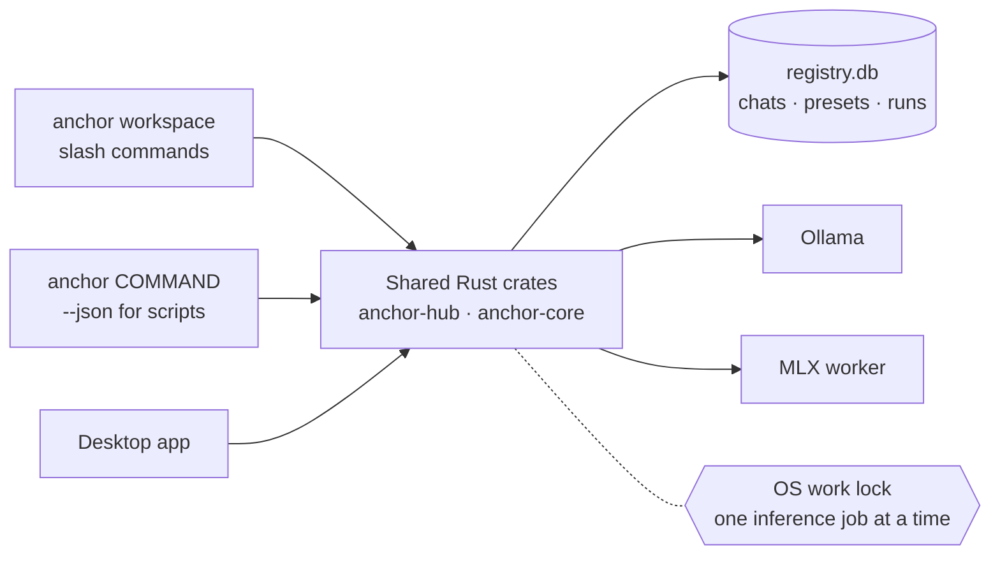

# CLI guide

The `anchor` CLI is the desktop app in a terminal. It uses the same Rust services and the same database, so chats, presets and benchmark history show up in both.

```sh
uv tool install anchr      # the PyPI package is anchr; the command is anchor
anchor                     # open the keyboard workspace
```



## The workspace

Run `anchor` (or `anchor tui`) in a real terminal.

| Key | Action |
|---|---|
| `/` | Search commands |
| Tab | Complete, or show more actions on a list item |
| Enter | Run, or take the primary action |
| Arrows, Page Up/Down | Move through lists (type to filter) |
| Esc | Back to the previous view |
| Ctrl-C | Clear the prompt or stop a job; press twice to quit or force |
| Ctrl-L | Refresh |

| Command | What it does |
|---|---|
| `/runtime` | Choose Ollama or MLX (`/runtime mlx` directly) |
| `/model`, `/models`, `/library` | Pick a local model, manage installed ones, find downloads |
| `/fit` | Memory-fit breakdown for a model |
| `/bench` | Set up and run a benchmark (asks for a model if needed) |
| `/results`, `/leaderboard`, `/sessions` | Browse saved measurements |
| `/chat`, `/compare` | Talk to a model, or run one prompt through two |
| `/activity` | Current or last job, with decode rate and TTFT |
| `/help`, `/quit` | Controls; quit (confirms if work is running) |

Jobs stay visible while you navigate, and benchmark, chat and preset drafts survive Esc until submitted. In a conversation, type and press Enter; replies stream into the transcript. Confirmations take `y` or `n`. Exporting evidence asks for a new filename and never overwrites a file. MLX covers downloads and benchmarking; chat, compare, fit and storage cleanup are Ollama-only.

## Commands

```bash
anchor models ls                            # installed models
anchor models browse --filter qwen          # everything on ollama.com
anchor models catalog --runtime mlx         # supported pinned MLX checkpoints
anchor models pull mlx-community/gemma-3-270m-it-4bit --runtime mlx
anchor models compare llama3.2:1b qwen3.5:9b "why is the sky blue?"
anchor fit deepseek-v2 --ctx 32768          # weights + KV cache + verdict
anchor chat -m llama3.2:1b                  # interactive; omit -m to continue with --conversation
anchor bench scenarios                      # what the suite measures
anchor bench run llama3.2:1b --repeats fast
anchor bench run llama3.2:1b --scenario classify --repeats fast
anchor bench run mlx-community/gemma-3-270m-it-4bit --runtime mlx --repeats fast
anchor bench ls --runtime mlx               # saved results, no live runtime needed
anchor bench top --scenario balanced        # rank every model on one workload
anchor bench sessions                       # includes failed/cancelled executions
anchor bench export SESSION_ID --include-content > evidence.json
anchor bench replay evidence.json           # offline recalculation from raw evidence
anchor bench validate llama3.2:1b           # validate Ollama measurements (alias: calibrate)
anchor bench report SESSION_ID              # saved settings and validation reports
anchor storage scan
anchor settings server --start
```

- **Runtimes.** `models ls|info|browse|pull` and `bench run|ls|top|samples` take `--runtime ollama|mlx` (default Ollama). MLX accepts a downloaded catalog ID or a local checkpoint directory. `bench top --runtime mlx` needs `--model` or `--reference` so only compatible tokenizer/template runs are ranked.
- **Repeats.** The CLI defaults to Thorough; pass `--repeats fast` to match the app's default.
- **Presets.** `anchor settings presets save ID --name NAME --system TEXT --num-ctx 8192` creates or edits one; unspecified fields stay unchanged, and `--clear system,num-ctx` resets fields. `anchor chat preset CONVERSATION_ID PRESET_ID` assigns it (omit the preset to reset).
- **Chat.** `anchor chat regenerate CONVERSATION_ID` replaces the newest reply. Chat and compare take `--file PATH` or `--stdin` for long prompts.

## Scripting

- `--json` puts the result on stdout; progress and errors go to stderr. `--host` targets a non-default Ollama.
- Exit codes: **0** success, **1** operational failure, **2** bad arguments, **130** interrupted.
- One-shot chat returns the conversation ID, model, cancellation state, response, thinking and stats. Compare returns both outcomes and exits nonzero if either fails. Interactive chat with `--json` needs a prompt, `--file` or `--stdin`.
- **Deletes ask first.** `models rm`, `chat rm` and `storage clean` prompt on stdin, so a piped run without `--yes` declines (returning a `declined` result) instead of deleting.
- **Stopping.** The first Ctrl-C gracefully stops chat, compare, downloads and benchmarks; partial chat output and finished benchmark evidence are kept. A second press exits immediately.

## Running alongside the app

The app and CLI are separate processes over the same database. An OS-owned work lock refuses a second inference, measurement, unload or removal while one is running, in either direction; reads always work, and the lock is released if its owner exits or crashes. Other apps and raw Ollama clients don't take the lock, so close them before benchmarking.
