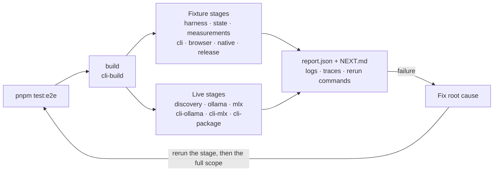
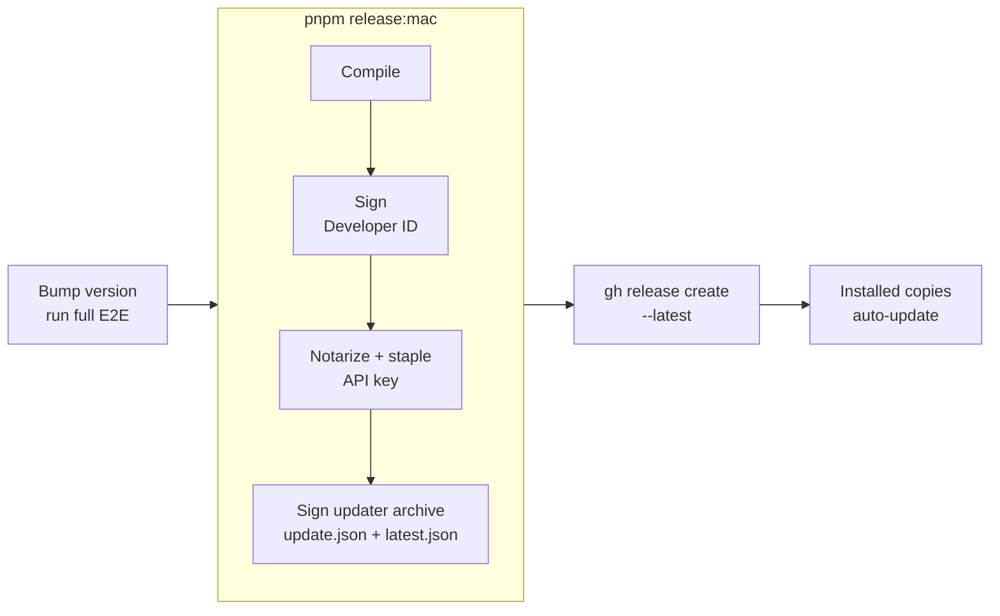

# Development, testing and releases

How to verify a change and how to ship the desktop app and the CLI. For setup, see [Build from source](../README.md#build-from-source).

## Testing: one entry point

```sh
pnpm test:e2e
```

There are no unit tests. One orchestrator runs purpose-built stages (processes, HTTP/SQLite, browser, native app, real runtimes) and is also what CI runs. Independent stages keep going after a failure; stages that depend on a failed build are marked **blocked**. Model and GPU work runs one stage at a time, and a repository lock stops two runs from fighting over ports or the GPU.



| Command | Scope |
|---|---|
| `pnpm test:e2e` | **Full** (default): everything, including real Ollama and MLX downloads and GPU runs |
| `pnpm test:e2e --profile fixtures` | No downloads or inference; includes the native app |
| `pnpm test:e2e --profile ci` | Fixtures without the native WindowServer; what GitHub Actions runs |
| `pnpm test:e2e --surface cli` | CLI only, including live CLI stages; no desktop build |
| `pnpm test:e2e --only native` | One stage (or several: `--only state,cli`) |
| `pnpm test:e2e --list` | Stage names and purposes |

**Prerequisites:** Apple Silicon, Rust, Node 20+, pnpm, Playwright Chromium, Ollama 0.32+ and uv. Native checks need a logged-in desktop and free port 4445; browser checks use 1420. Full scope downloads Gemma 3 270M (~1 GB across disposable stores) and takes several minutes. Your installed models and app database are never touched. Don't run other inference while live stages measure.

Each pass reports its scope (`passed-full`, `passed-cli-full`, `passed-fixtures`, `passed-ci`, `passed-selected`), so never claim more than the scope says. A missing prerequisite blocks the requested stage rather than silently skipping it.

| Exit code | Meaning |
|---|---|
| 0 | Every requested stage passed |
| 1 | A test or build failed |
| 2 | Missing prerequisite, lock held, bad arguments or a blocked stage |
| 130 | Interrupted; owned processes are stopped and results kept |

### Stages

| Stage | What it covers |
|---|---|
| `harness` | The runner itself: failure reports, blocked prerequisites, reruns, interruption cleanup |
| `build` / `cli-build` | Typecheck, frontend build, production Rust; CLI alone without the webview |
| `state` | SQLite migrations and reopen, library cache, bounded GGUF reads, safe storage cleanup |
| `measurements` | Streamed HTTP → benchmark evidence → SQLite → offline replay, including malformed and cancelled streams |
| `cli` | Real CLI processes: every catalog fit profile, `fit.json` references, chat, benchmarks, storage, and the terminal UI over a PTY |
| `cli-package` | Builds the `anchr` wheel and installs it with uv outside the checkout |
| `browser` | React workflows, recovery, keyboard, light/dark and 800–1440 px layouts (mocked IPC) |
| `native` | Real WKWebView → IPC → Rust → SQLite, persistence across relaunch, GUI/CLI lock contention |
| `discovery` | Published Ollama library → ranged GGUF header → stored architecture cache |
| `ollama` | Isolated Ollama: real generations, measurement validation, evidence replay |
| `mlx` / `cli-mlx` / `cli-ollama` | Clean download with cancel and retry, all nine workloads, history and replay through the GUI or CLI |
| `release` | Release script refuses missing credentials; updater config is public-only |

### Where things live

| Area | Owners |
|---|---|
| Memory fit | `crates/anchor-core/src/fit.rs`, mirrored in `apps/desktop/src/lib/kv.ts` + `fit.ts`; references in `tests/e2e/fixtures/fit.json`; live check `kv.verify.ts` ([fit methodology](fit-methodology.md)) |
| Benchmarks | `crates/anchor-hub/src/bench/` (`mod.rs`, `prompts.rs`, `evidence.rs`, `calibration.rs`), `mlx.rs`, `workers/mlx/` ([benchmark methodology](benchmark-methodology.md)) |
| Models and library | `anchor-hub` `library.rs`, `gguf.rs`, `ollama.rs`; frontend `ModelsHub`, `BrowsePage`, `useModels` |
| Chat and compare | `anchor-hub` `chat.rs`, `Registry::compare_cancellable`; CLI `chat.rs` |
| Persistence | `anchor-hub` `db.rs` (append-only `V*` migrations) |
| Storage | `anchor-hub` `storage.rs`, `StoragePage` |
| CLI | `crates/anchor-cli/src/` |
| Test runner | `scripts/test-e2e.mjs`, `tests/e2e/` |

### When a stage fails

1. Open `.internal/testing/latest.json` (and its `NEXT.md`). Find the **earliest** failure in the failing stage's log; blocked stages downstream are consequences, not extra bugs.
2. Reproduce with the report's `rerun` command. Decide whether it's a product bug, an outdated fixture, or a missing prerequisite.
3. Fix the root cause where it lives (domain logic in `crates/*`, never in the Tauri or CLI wrappers). Fix a fixture only to match the real contract, never to match a bug.
4. Rerun the stage and related ones (for example `--only cli,browser` after a fit change), then the original scope.

Never weaken an assertion to get a green run, and add new regressions at a public boundary (process, HTTP, SQLite, browser, native), not as helper microtests. Tests never sign, notarize, publish, install updates over your app, delete real models or read credentials.

### Not covered automatically

- Native open/save dialogs, real clipboard and browser sharing, and OS privacy prompts: check by hand when those flows change.
- Real signing, notarization and installing an update over an existing app: covered by the release steps below.
- Answer quality, cross-runtime equivalence, GPU-only timing and every model on every runtime release.

**Opt-in GPU tests.** With `ANCHOR_MLX_E2E_MODEL=/path/to/checkpoint`, run `cargo test -p anchor-hub --test mlx_suite_e2e -- --ignored --nocapture`, or `pnpm --filter @anchor/desktop test:e2e:native` for the full GUI → worker → GPU path. `ANCHOR_MLX_DOWNLOAD_E2E=1 pnpm --filter @anchor/desktop test:e2e:native` exercises a first-time MLX install into an empty temporary cache.

## Releasing the desktop app



**One-time setup** (credentials never go in the repo or on the command line):

- A **Developer ID Application** certificate in the login keychain. With more than one, set `APPLE_SIGNING_IDENTITY`.
- An **App Store Connect API key** at `~/private_keys/AuthKey_<KEYID>.p8`, with the issuer ID in `~/private_keys/issuer_id`. Notarization is API-key only; there is deliberately no app-specific-password fallback.
- The **updater signing key** at `~/.tauri/anchor.key` (or `TAURI_KEY_PATH`), with its password in the keychain item `anchor-updater-key`.
- An **accepted Apple Developer agreement**. An expired one makes notarization fail with HTTP 403.

**Each release:**

1. Bump the version in `Cargo.toml` (workspace), `package.json`, `apps/desktop/package.json` and `apps/desktop/src-tauri/tauri.conf.json`, then refresh `Cargo.lock`.
2. Run `pnpm test:e2e` and commit.
3. Build, sign and notarize:

   ```sh
   pnpm release:mac
   ```

   The `--no-sign` warning during compilation is expected: signing happens in the bundling step that follows.
4. Publish (it must be marked latest, never a prerelease, or the updater won't see it):

   ```sh
   V=1.0.3
   gh release create v$V \
     target/release/bundle/dmg/Anchor_${V}_aarch64.dmg \
     target/release/bundle/macos/Anchor.app.tar.gz \
     target/release/bundle/macos/Anchor.app.tar.gz.sig \
     target/release/bundle/update.json \
     target/release/bundle/latest.json \
     --title "Anchor v$V" --latest --generate-notes
   curl -fsSL https://github.com/amapara27/anchor/releases/latest/download/update.json | grep '"version"'
   ```

`update.json` is what current copies read, and it carries the minimum macOS version they check before installing. `latest.json` serves copies older than that check and intentionally stays pinned to the bridge release.

## Publishing the CLI

The CLI ships to PyPI as `anchr` (command `anchor`) from `.github/workflows/publish-cli.yml`, separately from the app's `v*` releases. It uses PyPI Trusted Publishing, so no API token is stored.

**One-time setup:** add a GitHub publisher in [PyPI's publishing settings](https://pypi.org/manage/account/publishing/) (project `anchr`, owner `amapara27`, repository `anchor`, workflow `publish-cli.yml`, environment `pypi`), and create a `pypi` environment under GitHub **Settings → Environments**, ideally with a required reviewer.

**Each release:**

```sh
pnpm test:e2e --only cli-package     # build the wheel and check an isolated uv install
git tag cli-v1.0.3                   # must match the workspace Cargo version
git push origin cli-v1.0.3
```

The macOS job runs the CLI fixtures and the wheel check, then a separate Ubuntu job uploads that exact wheel once the `pypi` environment approves. Running the workflow manually builds and checks without publishing. Only the Apple Silicon wheel is published; other platforms need their own install checks first.

Users update with `uv tool upgrade anchr`.
