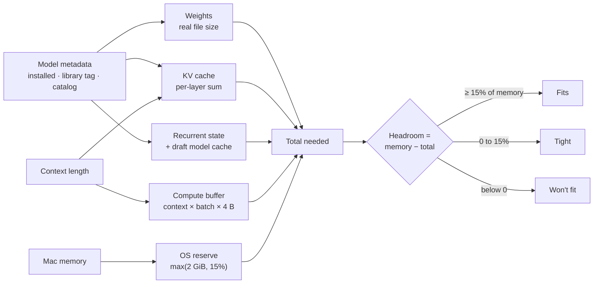

# Fit methodology

**Verified against Ollama 0.40.15 (llama-server runner, llama.cpp `c406f4367e19`) · Updated November 19, 2026**

Anchor tells you whether a model fits your Mac before you download or load it. This page covers how the verdict is computed, where each number comes from, how closely it matches what Ollama actually allocates, and where it can be wrong.

## The short version

- **One engine, every surface.** The catalog, library, pickers, inspector and `anchor fit` all use the same math. It lives in Rust (`crates/anchor-core/src/fit.rs`) with a TypeScript mirror (`apps/desktop/src/lib/kv.ts` + `fit.ts`) so the context selector recomputes instantly. Shared byte-valued fixtures keep the two identical.
- **Memory needed = weights + KV cache + compute buffer + OS reserve**, compared with the Mac's unified memory.
- **The KV cache is rebuilt layer by layer from the model's GGUF metadata.** It averages **1.9% error and never under-predicts** across 33 live checks on 11 models.
- **Missing metadata falls back to a parameter-count estimate**, labeled as such (`~` in the app, `kv_source: "estimated"` in JSON).
- **It is a load-time prediction.** Memory that grows during use (the prompt cache) and other apps' memory are out of scope.



## The verdict

| Term | How it is computed |
|---|---|
| Weights | Real on-disk size when known, else parameters × bits-per-weight |
| KV cache | Per-layer sum from metadata, plus recurrent state and any draft model's cache |
| Compute buffer | `context × n_batch × 4` bytes |
| OS reserve | `max(2 GiB, 15% of total memory)` |

`headroom = total memory − (weights + KV + compute buffer + OS reserve)`

| Tier | Condition |
|---|---|
| **Fits** | headroom ≥ 15% of total memory |
| **Tight** | 0 ≤ headroom < 15% |
| **Won't fit** | headroom < 0; the app shows the shortfall ("needs 4.2 GiB more") |
| **Unknown** | host memory or parameter count unknown; no guess is shown |

Memory figures use binary units (GiB = 1024³ bytes). Download sizes from ollama.com are decimal GB, as published.

**Context.** Ollama loads models at a small default context, not their advertised maximum, so the default verdict uses **4,096 tokens** (capped by the model's own limit). A 128K model judged at 128K could read "won't fit" on a Mac where it runs fine. The header selector re-judges everything at 2K–128K; `anchor fit --ctx N` takes any value.

## Weights

1. **Installed models** use the byte count Ollama reports (`/api/tags`). It already includes any vision projector and draft model in the manifest.
2. **Library tags** use the published download size.
3. **Otherwise** parameters × bits-per-weight: Q3_K_S 3.5, Q4_K_M 4.8, Q5_K_M 5.6, Q8_0 8.5. Unknown quants count as Q4_K_M, which is why a real size always wins.

## KV cache

The KV cache stores keys and values for every token in context, on every attention layer. Anchor rebuilds llama.cpp's allocation:

```
for each layer that owns a cache:
    bytes += kv_heads(layer) × width(layer) × 2 bytes (f16) × cells(layer)
```

**Which layers own a cache**

- **Main layers** = `block_count − nextn_predict_layers`. Multi-token-prediction (MTP) heads are counted in `block_count` but cache nothing.
- **Shared KV** (Gemma 3n, Gemma 4): only the first `main − shared_kv_layers` layers own a cache; the rest reuse it.
- **Hybrids** (attention mixed with state-space or convolution layers) cache only on attention layers, read from a `recurrent_layers` array, a per-layer `head_count_kv` array (0 = none), or `full_attention_interval`.

**Heads and width**

- **KV heads** come from a per-layer `head_count_kv` array when present (Gemma 4 26B/31B: 8 on windowed layers, 2 on global), else the scalar.
- **Width** is `key_length + value_length`, falling back to `embedding_length / head_count` for each. Windowed layers use `key_length_swa` / `value_length_swa` when declared.
- **MLA** (DeepSeek-style latent attention): without `key_length_mla`/`value_length_mla` keys (Ollama's deepseek-v2) llama.cpp caches full per-head K and V. With both keys it caches the compressed latent, K only.

**Cells.** llama.cpp pads every cache to a multiple of 256 cells.

- Global layers hold `pad256(context)` cells.
- Sliding-window layers hold `pad256(min(context, window + n_batch))`: the window plus room for the batch in flight. Gemma 4 allocates 1,536 cells for a 512-token window at batch 1024.

Windowed layers come from a GGUF `sliding_window_pattern` array (Gemma 3n, Gemma 4, OLMo 3), else from the layout llama.cpp hardcodes per architecture:

| Architecture | Every Nth layer is global | Notes |
|---|---:|---|
| gemma2, gpt-oss | 2 | |
| gemma3, gemma4 (fallback) | 6 | |
| gemma3n | 5 | |
| cohere2, olmo2, exaone-moe | 4 | |
| exaone4 | 4 | 64-layer variant only |
| cohere2moe, smallthinker | 4 | dense-first; smallthinker forces a 4,096 window |
| llama4 | 4 | 8,192-token chunks |
| lfm2, lfm2moe | — | every attention layer windowed |

An architecture with neither is **dense**. llama.cpp ignores a declared `sliding_window` it has no layout for (qwen2, mistral, phi3), and treating those layers as global errs high, the safe direction.

## Recurrent state and draft models

**Recurrent state.** Hybrid and recurrent models also hold a fixed f32 state per recurrent layer that doesn't grow with context:

| Family | Floats per recurrent layer |
|---|---|
| Mamba-style (mamba, mamba2, jamba, falcon-h1, granitehybrid, plamo2, qwen3next, qwen3.5) | `(conv_kernel − 1) × (inner + 2 × groups × state) + state × inner` |
| LFM2 short convolution | `embedding_length × (l_cache − 1)` |

**Speculative draft models.** Ollama 0.40 loads a small drafter beside models whose manifest has a `draft` layer. The drafter guesses tokens and the main model checks them. Its weights are in the download size; its cache is added here:

- A drafter caches only its trailing `nextn_predict_layers` at the target's context (qwen3.5:0.8b: one layer, 64 MiB at 32K).
- **gemma4-assistant adds nothing**: llama.cpp maps its layers onto the target's existing cache.
- While a drafter is loaded, qwen3.5's recurrent state keeps `draft_num_predict` extra rows so rejected guesses can be rolled back. That value comes from the model's parameters (Ollama's default is 4).

An installed model's drafter is read from its GGUF in Ollama's local store, because `/api/show` doesn't describe it.

## Compute buffer

Ollama enables flash attention, so the part that grows with context is the attention mask: `n_batch × 4` bytes per token (measured slope on llama3.2:1b: exactly 4,096 B/token at batch 1024). The fixed ~128 MiB graph overhead is left to the OS reserve.

`n_batch` follows Ollama's rule: **512 up to 4K, 1024 up to 32K, 2048 above** (`server/sched.go`). Ollama steps it down only under memory pressure at load time, which no pre-load estimate can know, so Anchor uses the proposal and errs high when that happens.

## Where the metadata comes from

| Model | Source | Cached |
|---|---|---|
| Installed | Ollama `/api/show` `model_info` | until re-pulled |
| Library tag | Ranged read of the GGUF header from the registry (about 1 MB, never the weights) | per manifest digest |
| Catalog, not installed | `crates/anchor-core/profiles/models.json`, from `node tools/generate-arch.mjs` | in the repo |

Keys are matched as `{architecture}.{suffix}` so a vision tower's `clip.vision.*` keys never leak in. Per-layer arrays are kept up to 4,096 entries. Ollama before 0.40 omits arrays from `/api/show`, so on older servers the hardcoded layouts apply and array-only hybrids fall back to the estimate (48–320 KiB per token, by parameter count).

## Accuracy

`apps/desktop/src/lib/kv.verify.ts` loads each model in a live Ollama at several contexts and compares the engine with llama.cpp's own allocation lines in the server log (`llama_kv_cache: size`, `llama_memory_recurrent: size`, drafter `KV buffer size`). It reads the log rather than `/api/ps` because Ollama's resident size swings by gigabytes as weights shift between Metal and CPU.

**Ollama 0.40.15, 16 GB Apple Silicon Mac, f16 KV, 33 samples across 11 models:**

| Metric | Result |
|---|---:|
| Exact to the byte | 25 / 33 (76%) |
| Within 10% | 32 / 33 (97%) |
| Mean absolute error | 1.9% |
| Byte-weighted error | +2.6% (+720 MiB of 27,750 MiB) |
| Worst case | +16.7% (16 MiB) |
| Under-predictions | 0 |
| Recurrent state / draft caches | 12 / 12 and 6 / 6 exact |

Every miss is an over-prediction from one cause: Ollama chose batch 512 instead of its usual proposal, which shrinks sliding-window caches. At the proposed batch, all 33 are exact.

| Model | Rule exercised | Result |
|---|---|---|
| llama3.2:1b (8K–64K) | dense GQA | exact |
| deepseek-v2 (2K, 4K) | MLA, full cache | exact |
| gemma3:270m | hardcoded window (6) | exact |
| gemma4:e2b | window pattern, shared KV, drafter | exact |
| qwen3.5:0.8b | hybrid via `recurrent_layers`, drafter + rollback rows | exact |
| qwen3.5:9b | hybrid via per-layer `head_count_kv` | exact |
| granite4:350m-h | Mamba hybrid | exact |
| lfm2.5-thinking:1.2b | short-convolution hybrid | exact |
| command-r7b (6K, 8K) | hardcoded window (4) | +7.7%, +7.0% (batch 512) |
| olmo-3:7b | window pattern, MHA | +3.3% to +7.0% (192 MiB, batch 512) |
| gemma3n:e2b | window pattern, shared KV | +5.6% to +16.7% (16 MiB, batch 512) |

**Before this engine** (v1.0.2, same server): 53% of samples exact, 130% mean error, worst +500%, and 3 under-predictions; gemma4:e2b read 22–30% low and qwen3.5:0.8b 4× high.

Byte-exact references from these runs, plus rules taken from llama.cpp source, live in `tests/e2e/fixtures/fit.json`. `pnpm test:e2e` runs every case through the real `anchor fit` CLI and the rendered inspector.

## Known limits

- **Vision/audio encoder compute** (101–665 MiB measured). llama-server reserves it at load as an allocator peak, with no closed form, and it grows with larger images. Not predicted.
- **Draft model compute** (~140 MiB). No derived formula; not predicted.
- **Prompt cache.** llama-server keeps past prompts in host RAM (up to 8 GiB by default), growing from zero during use. On a 16 GB Mac a long session can eat into the OS reserve.
- **Batch step-down.** Under memory pressure, windowed caches come in up to 192 MiB below the prediction (see above).
- **Unverified architectures.** `glm4moelite` (rewritten to MLA by Ollama, confirmed from source only) and `mllama` (no translation in Ollama 0.40). `nemotron_h`, `rwkv` and Kimi linear attention use state formulas Anchor doesn't model.
- **Non-default settings.** `OLLAMA_KV_CACHE_TYPE=q8_0`/`q4_0` and parallel slots change the KV cache; Anchor models Ollama's defaults.

## Reproduce

```sh
anchor fit qwen3.5:9b --ctx 32768          # breakdown with the KV source
anchor --json fit gemma4:e2b --ctx 32768   # machine-readable result
```

```
qwen3.5:9b   Q4_K_M   9.7B   arch qwen35 · 32 layers · per-layer kv heads

  context      32768 (max 262144)
  weights      6.14 GiB
  kv cache     1.05 GiB   (33.6 KiB/token, from metadata)
  compute buf  0.12 GiB
  os reserve   2.40 GiB
  ─ total      9.72 GiB of 16.00 GiB   headroom 6.28 GiB   → ok
```

Check predictions against a live server (models must be installed; reads `~/.ollama/logs/server.log` or `OLLAMA_LOG`):

```sh
node --experimental-strip-types apps/desktop/src/lib/kv.verify.ts llama3.2:1b gemma4:e2b
KV_VERIFY_CONTEXTS=2048,4096 node --experimental-strip-types apps/desktop/src/lib/kv.verify.ts deepseek-v2
```

## History

- **November 19, 2026 (v1.0.3).** Per-layer engine: window patterns and per-layer heads from GGUF arrays, hybrids and recurrent state, K-only MLA, MTP layers, 256-cell padding, llama.cpp's per-architecture layouts, draft models, Ollama's batch rule and its glm4moelite translation. Cached metadata is cleared on upgrade (schema 14) so installed models re-read it.
- **October 2026.** Dense, MHA, full-cache MLA, Gemma sliding window and shared KV, verified on Ollama 0.32. Compute buffer corrected to the flash-attention mask term.

## References

- llama.cpp `src/llama-kv-cache.cpp`, `llama-kv-cache-iswa.cpp`, `llama-memory-recurrent.cpp`, `llama-hparams.cpp`, `src/models/<arch>.cpp` (commit `c406f4367e19`)
- Ollama `server/sched.go` (batch rule) and `llama/compat/llama-ollama-compat.cpp` (format rewrites)
- [Benchmark methodology](benchmark-methodology.md) for measured speed and observed memory after a run
